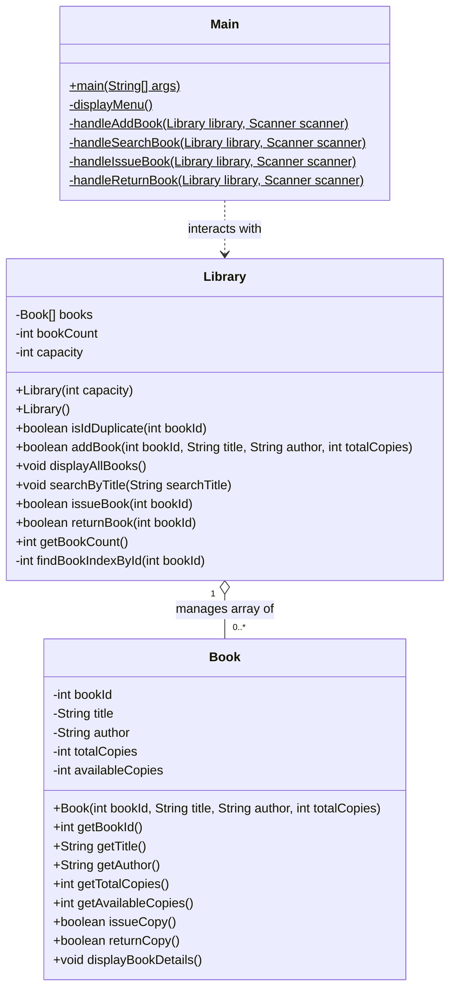

# COLLEGE MICROPROJECT REPORT
## Subject: Object-Oriented Programming with Java
### Project Title: College Library Management System

---

### Project & Student Information
- **Title of Microproject:** College Library Management System
- **Academic Year / Semester:** [Insert Academic Year / Semester e.g., 2024–2025 / Sem III]
- **Course Title & Code:** Object-Oriented Programming with Java [Insert Course Code]
- **Name of Student / Group Members:**
  1. [Student Name 1] - [Enrollment / Roll No.]
  2. [Student Name 2] - [Enrollment / Roll No.]
  3. [Student Name 3] - [Enrollment / Roll No.]
- **Department:** Department of Computer Engineering / Information Technology
- **Name of Guide / Faculty Mentor:** [Insert Mentor Name & Designation]
- **Name of Institution:** [Insert College / Institution Name]

---

## 1. Abstract
The **College Library Management System** is a console-driven Java software application developed as an academic microproject to demonstrate the practical application of Object-Oriented Programming (OOPS) concepts, with a primary focus on **Encapsulation** and **Data Hiding**. In academic institutions, library book tracking done through traditional registers often leads to inconsistencies, duplicate accession numbers, and manual counting errors. This application automates the cataloging, title-based retrieval, and stock-controlled issuance and return of library books. Built strictly using syllabus-aligned Java constructs—such as private access modifiers, constructors, accessor methods, arrays of objects, and robust input validation—the software ensures that sensitive inventory state cannot be altered directly or corrupted. The project illustrates how basic object-oriented design solves real-world workflow challenges effectively without depending on external frameworks or databases.

---

## 2. Introduction
In educational organizations, library operations form a critical part of academic infrastructure. A library stores diverse titles across numerous branches of engineering and basic sciences. Manual book lending procedures involve labor-intensive registry entries where stock discrepancies occur frequently.

To address these challenges within the scope of college-level Java programming, this microproject delivers a modular, menu-based management utility. It structures books as standalone objects encapsulating both data (book ID, title, author, total stock, available stock) and behaviors (safe issuance and returns).

---

## 3. Problem Statement
Design and develop a robust, beginner-friendly Java console application that manages a college library's collection of books. The system must allow the librarian to:
1. Add new books with duplicate ID validation and positive stock checks.
2. Display all registered books in an aligned tabular overview.
3. Perform case-insensitive keyword searches on book titles.
4. Issue available copies while preventing stock depletion below zero.
5. Return issued copies while strictly preventing available stock from exceeding total owned stock.
6. Provide an intuitive menu-driven loop that gracefully recovers from invalid user inputs.

---

## 4. Objectives
- To understand and implement **Encapsulation** by restricting direct access to object attributes.
- To use **Constructors** for initializing state variables securely.
- To manage collections of objects using **Arrays of Objects** (`Book[]`).
- To implement business logic validation (issue/return constraints) within class methods.
- To build a clean, modular, and failure-tolerant console interface using Java `Scanner` and `switch-case`.

---

## 5. Scope & Limitations
### Scope
- Inventory tracking for up to a fixed catalog capacity (e.g., 50–100 distinct titles).
- Real-time stock counting for each book title.
- Protection against duplicate book IDs and negative stock quantities.

### Limitations
- **In-Memory Volatility:** All records reside in main memory (RAM); data is lost when the program closes.
- **No Individual Student Profiles:** The system tracks bulk stock availability rather than linking specific book serials to student roll numbers or calculating overdue fines.
- **Fixed Array Size:** The storage capacity is defined at library creation time and is constrained by the array size.

---

## 6. Functional Requirements
1. **Add Book:** Accepts Book ID, Title, Author, and Total Copies; checks for duplicate ID and capacity.
2. **Display Catalog:** Prints all registered books in formatted tabular form with live stock metrics.
3. **Search Title:** Searches books matching user keyword regardless of letter casing.
4. **Issue Book:** Decrements available copies if available > 0; rejects if zero.
5. **Return Book:** Increments available copies if available < total copies; rejects if all copies are already present.
6. **Menu Navigation:** Repeats until option 6 (Exit) is chosen. Rejects non-numeric characters without crashing.

---

## 7. Software and Hardware Requirements
### Hardware Requirements
- **Processor:** Dual Core 2.0 GHz or higher (Intel/AMD)
- **RAM:** Minimum 2 GB (4 GB recommended)
- **Hard Disk Space:** Minimum 100 MB free disk space
- **Input / Output:** Standard keyboard and display monitor

### Software Requirements
- **Operating System:** Windows 10/11, Linux, or macOS
- **JDK:** Java Development Kit (JDK 8 or above; tested and verified on JDK 24)
- **Editor / IDE:** Any basic text editor (VS Code, Notepad++) or Java IDE (NetBeans, Eclipse, IntelliJ IDEA)

---

## 8. Java OOPS Concepts Used
| OOPS Concept | Implementation in Project | Academic Significance |
| :--- | :--- | :--- |
| **Classes & Objects** | `Book`, `Library`, and `Main` | Translates real-world entities into software blueprints and runtime instances. |
| **Encapsulation** | `private` variables in `Book` and `Library` with `public` accessors | Prevents unauthorized external modification; enforces data hiding. |
| **Constructors** | Parameterized `Book(id, title, author, total)` and `Library(capacity)` | Ensures objects start in a predictable, fully-initialized valid state. |
| **Arrays of Objects** | `private Book[] books` inside `Library` | Demonstrates storing and iterating over structured object instances in memory. |
| **Control Structures & Methods** | Loops (`for`), branching (`if-else`, `switch`), helper methods | Enforces clean control flow, code modularity, and readable separation of concerns. |

---

## 9. System Design and Class Responsibilities

### Class Responsibilities:
1. **`Book`**: Represents a physical book title and holds encapsulated data. Contains atomic operations `issueCopy()` and `returnCopy()` ensuring stock count integrity.
2. **`Library`**: Maintains an array of `Book` references. Coordinates higher-level actions including duplicate checking, searching by title, and delegating issue/return operations.
3. **`Main`**: Acts as the user interface layer. Renders the interactive terminal menu, parses scanner tokens, handles input errors, and delegates requests to the `Library` instance.

---

## 10. Algorithm & Program Flow

### Algorithm: Add Book
1. Start.
2. Check if `bookCount >= capacity`. If yes, display "Library storage full" and return `false`.
3. Read `bookId`. Loop through stored books from index `0` to `bookCount - 1`.
4. If any book matches `bookId`, display "Duplicate ID" and return `false`.
5. Read `totalCopies`. If `totalCopies <= 0`, display "Invalid count" and return `false`.
6. Read `title` and `author`. If blank, display error and return `false`.
7. Instantiate `books[bookCount] = new Book(bookId, title, author, totalCopies)`.
8. Increment `bookCount` by 1.
9. Display "Book added successfully!" and return `true`.
10. Stop.

### Algorithm: Issue Book
1. Start.
2. Read `bookId`.
3. Search for `bookId` in `books[]`. If not found, display "Book does not exist" and return `false`.
4. If found, call `book.issueCopy()`.
5. Inside `issueCopy()`, check if `availableCopies > 0`:
   - If true: decrement `availableCopies` by 1 and return `true`.
   - If false: return `false`.
6. If `issueCopy()` returned `true`, display updated available copies and return `true`.
7. Else, display "All copies are currently issued out!" and return `false`.
8. Stop.

### Algorithm: Return Book
1. Start.
2. Read `bookId`.
3. Search for `bookId` in `books[]`. If not found, display "Book does not exist" and return `false`.
4. If found, call `book.returnCopy()`.
5. Inside `returnCopy()`, check if `availableCopies < totalCopies`:
   - If true: increment `availableCopies` by 1 and return `true`.
   - If false: return `false`.
6. If `returnCopy()` returned `true`, display updated available count and return `true`.
7. Else, display "All copies are already present in the library!" and return `false`.
8. Stop.

---

## 11. Implementation Explanation
- **Encapsulation Mechanism:** By setting variables to `private`, external code cannot do `book.availableCopies = -5;` or `book.availableCopies = 999;`. Any state modification must pass through `issueCopy()` and `returnCopy()`, which enforce domain invariants mathematically.
- **Array Traversal:** The `Library` class uses linear scanning (`for (int i = 0; i < bookCount; i++)`) to search for matching records, which is both syllabus-compliant and straightforward to explain.
- **Input Buffer Clearing:** A common pitfall in Java console programs is `scanner.nextInt()` leaving the newline character in the buffer, which causes subsequent `scanner.nextLine()` calls to skip. The `Main` class systematically calls `scanner.nextLine()` after integer inputs, preventing unexpected input skipping or infinite loops.

---

## 12. Test Cases and Execution Results
All test cases were executed and validated on the JVM using `AutomatedTestSuite.java`.

| Test ID | Scenario Description | Input Data / Action | Expected Result | Actual Result | Status |
| :--- | :--- | :--- | :--- | :--- | :--- |
| **TC-01** | Display Empty Library | Select option 2 before adding books | Display informational message stating library is empty | Message displayed; no crash | **PASS** |
| **TC-02** | Add Valid Book | ID: 101, Title: "Java", Author: "Herbert", Copies: 3 | Book created, stored, success message shown | Book stored, `bookCount = 1` | **PASS** |
| **TC-03** | Reject Duplicate ID | ID: 101 entered again | Error displayed; reject addition | Error message displayed; count remains 1 | **PASS** |
| **TC-04** | Reject Zero/Negative Copies | ID: 102, Copies: 0 or -2 | Error displayed; reject addition | Error message displayed; rejected | **PASS** |
| **TC-05** | Storage Capacity Exceeded | Add books beyond defined capacity | Display storage full error; reject addition | Rejected safely with warning | **PASS** |
| **TC-06** | Issue Available Book | Issue Book ID: 102 (Copies: 1) | Available copies decremented from 1 to 0 | Success message; Remaining: 0 / 1 | **PASS** |
| **TC-07** | Reject Issue When Out of Stock | Issue Book ID: 102 when stock is 0 | Error displayed; issue rejected | Error message shown; stock remains 0 | **PASS** |
| **TC-08** | Return Issued Book | Return Book ID: 102 | Available copies incremented from 0 to 1 | Success message; Updated: 1 / 1 | **PASS** |
| **TC-09** | Reject Return When Stock Full | Return Book ID: 102 when available == total | Error displayed; return rejected | Error message shown; stock remains 1 | **PASS** |
| **TC-10** | Issue Non-Existent Book | Issue Book ID: 999 | Error displayed; book not found | Error message displayed | **PASS** |
| **TC-11** | Return Non-Existent Book | Return Book ID: 999 | Error displayed; book not found | Error message displayed | **PASS** |
| **TC-12** | Search by Title Keyword | Search "java" | Finds and displays "Java Programming" (case-insensitive) | Formatted table with matching row printed | **PASS** |

---

## 13. Future Enhancements
1. **File Handling / Serialization:** Persist catalog data into a local text or binary file (`books.txt` or `books.dat`) using `ObjectOutputStream` so records remain between runs.
2. **Student Member Management:** Introduce a `Student` entity to record which student borrowed which specific book and track issue dates.
3. **Dynamic Collections:** Upgrade the fixed `Book[]` array to `ArrayList<Book>` to dynamically grow capacity as needed.
4. **Graphical User Interface (GUI):** Implement a desktop window using Java Swing or JavaFX for button-based interactions.

---

## 14. Conclusion
The **College Library Management System** successfully accomplishes all predefined objectives. By utilizing core Object-Oriented principles, specifically **Encapsulation**, the application models real-world library operations while keeping code simple, clean, and robust against invalid inputs. The modular architecture cleanly separates concerns across entity modeling, business collection logic, and console interaction, making it an ideal microproject for an introductory Java OOPS course.
